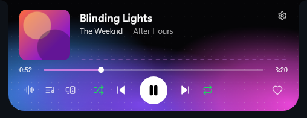
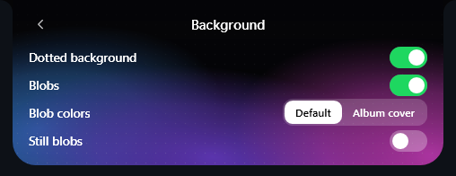
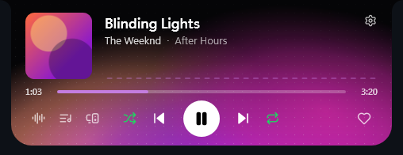
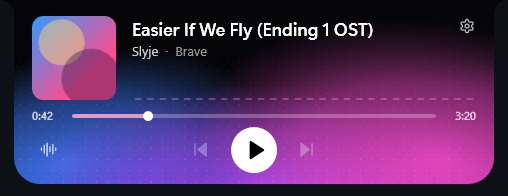
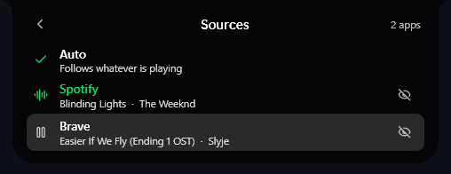

# Pulsenotch

**A hover-to-reveal now-playing notch for Windows 11.**
Push the mouse to the very top-centre of your screen and a notch drops down, with the cover, the title, a live audio
visualizer and playback controls, for Spotify, YouTube in your browser, Apple Music and any other app that uses the Windows media controls. Move away and it retracts. It is invisible the rest of the time and costs almost nothing while hidden.

<p align="center">
  
</p>

<table>
  <tr>
    <td align="center"><br><sub>Peek bar on track changes</sub></td>
    <td align="center"><br><sub>Background settings, with a live preview</sub></td>
  </tr>
  <tr>
    <td align="center"><br><sub>"Album cover" blob colours</sub></td>
    <td align="center"><br><sub>A browser video: no Spotify-only buttons, no skipping</sub></td>
  </tr>
  <tr>
    <td align="center" colspan="2"><br><sub>Sources: Auto follows whatever is playing, or pin or hide an app</sub></td>
  </tr>
</table>

> Unofficial hobby project. It is not affiliated with or endorsed by Spotify; Spotify is a trademark of Spotify AB.

## Features

- **Hover or hotkey.** Open it by hovering the top-centre edge or with `Ctrl+Alt+N`. Hover can be switched off completely (hotkey only).
- **Now playing for any app.** Spotify, YouTube and other sites in your browser, Apple Music, VLC and anything else that shows up in the Windows
  media controls. Cover, title, artist, a scrubbable progress bar, play / pause / skip (where the app allows it) and scroll-wheel volume for that
  app. This uses the Windows media sessions, so it needs **no login**. By default it follows whatever is playing; you can pin or hide apps.
- **Live audio visualizer** driven by whatever your default output device is playing.
- **A living background:** a faint dot grid and soft neon blobs that drift slowly. Blob colours are either the neon default (leaning toward the
  cover) or taken straight from the cover. Everything is switchable from the gear icon, with a live preview.
- **Peek bar** that briefly shows the new track when the song changes.
- **Optional Spotify account features** (one-time login): like the current song, shuffle, repeat, switch playback device, see what is up next.
- **Smooth.** Animations run at your display's refresh rate (measured at 132-144 updates per second on a 144 Hz screen), and buttons fade their
  hover highlight in and out.
- **Stays out of the way.** Suppressed while a fullscreen game or app is active, click-through everywhere except the notch itself, and the
  window is hidden (no render loop at all) whenever the notch is retracted.

## Getting started

**Requirements:** Windows 11 and the [.NET 8 SDK](https://dotnet.microsoft.com/download/dotnet/8.0) to build. Any app that uses the Windows media controls
works as a source; the Spotify desktop app additionally unlocks the optional account features below.

```powershell
git clone https://github.com/cosmo030/pulsenotch.git
cd pulsenotch
dotnet publish -c Release -o publish --no-self-contained
publish\SpotifyNotch.exe
```

(The executable and namespace are still called `SpotifyNotch` internally; the project name is Pulsenotch.)

Other launch options:

```
SpotifyNotch.exe --demo    # fake track and fake Spotify account, no Spotify needed (handy for UI work)
SpotifyNotch.exe --open    # open the notch on launch
SpotifyNotch.exe --perf    # log frame timings to %APPDATA%\SpotifyNotch\log.txt
```

The tray icon lets you toggle the hover trigger, the peek bar, the visualizer, the background blobs and dots, reduce motion, **Start with Windows**
(off by default), open the settings file, or exit.

## Using it

| Action | Result |
|---|---|
| Cursor to the top-centre edge (150 ms dwell) | The notch drops down; moving away retracts it |
| `Ctrl+Alt+N` | Toggle the notch (works with hover disabled) |
| Song changes | A slim "peek" bar shows the new track for a moment |
| Scroll wheel over the notch | Spotify's volume (its slider in the Windows volume mixer) |
| Click or drag the progress bar | Seek |
| Skip next / previous | The cover slides in the direction you skipped, and the blobs glide to the new colours |
| Sources button (bottom left) | Choose which app the notch follows: **Auto** (whatever is playing, the most recently started if several), pin one app, or hide apps you never want |
| Gear icon (top right) | Background settings: dotted background, blobs, blob colours (Default or Album cover), still blobs |
| Heart, shuffle, repeat, devices (needs a Spotify login) | Like the song, toggle shuffle, cycle repeat, pick a playback device |

## Supported sources

Windows lists every app that plays media in its media controls (the overlay next to the volume flyout). Pulsenotch reads that list, so there is
nothing to configure per app.

| | |
|---|---|
| **Which app is shown** | Auto: the app that is playing wins; if two play, the one that started most recently; while it keeps playing it stays. Nothing playing: the last app you used. You can pin an app or hide apps on the Sources page. |
| **What the notch shows** | Title, artist or channel, cover or video thumbnail, progress, live-stream state. Controls the app does not support (a browser video has no next/previous) are dimmed, and the Spotify-only buttons (like, shuffle, repeat, devices, queue) appear only for Spotify. |
| **Volume wheel** | Moves that app's own slider in the Windows volume mixer (falls back to the master volume if the app has none). |
| **Tested** | Spotify, and a YouTube video in Brave (play, pause, seek, volume, cover). Chrome, Edge and Firefox behave the same way through Windows. |
| **Not tested** | Apple Music, iTunes, VLC and other players: they should work through the same path, and their names are recognised, but I have not run them. |

Limits: Windows only reports the app (`Brave`), never the website, so a browser is one source and cannot be labelled "YouTube", and every tab in a browser
counts as that browser. Apps that do not use the Windows media controls cannot be detected.

## Connecting your Spotify account (optional)

The local controls work without it. Likes, shuffle, repeat and devices use the Spotify Web API and need a one-time login:

1. Create an app at <https://developer.spotify.com/dashboard> with the **Web API** enabled and the redirect URI `http://127.0.0.1:5543/callback`.
   Spotify requires the app owner to have **Premium** for apps in development mode, and limits them to 5 users.
2. Put the app's **Client ID** (not the secret) into `settings.json` as `SpotifyClientId`.
3. Click **Connect Spotify** in the notch (or the tray menu) and approve in your browser.

Login uses OAuth with PKCE, so there is no client secret anywhere. The token is stored encrypted for your Windows user in
`%APPDATA%\SpotifyNotch\spotify-token.dat`; *Disconnect Spotify* in the tray menu deletes it. Failed API calls are written to
`%APPDATA%\SpotifyNotch\log.txt`.

## Settings

`%APPDATA%\SpotifyNotch\settings.json` (tray menu, *Open settings file*). Restart the app after changing the hotkey.

| Key | Meaning |
|---|---|
| `HoverEnabled`, `HoverDelayMs`, `Hotkey` | Hover trigger on/off (off = hotkey only, and the hover check then does no work), its dwell time, and the global hotkey |
| `PeekOnTrackChange`, `Visualizer` | Peek bar on song change; the audio visualizer |
| `Blobs`, `DotGrid` | The drifting colour blobs and the dot texture (both off = plain black) |
| `BlobColors` | `"Default"` (neon cyan / violet / magenta, leaning toward the cover) or `"Album"` (colours taken from the cover) |
| `ReduceMotion` | Keep the blobs from drifting |
| `SoftwareRendering` | `true` (default) presents at the display refresh rate at some CPU cost while the notch is open; `false` uses WPF's GPU renderer (about half the update rate) |
| `LayeredWindow` | `false` (default) uses a GPU-composited window made transparent by DWM; `true` falls back to the classic WPF transparent window |
| `PinnedSource` | Follow only this app (its media-session id, e.g. `Spotify.exe` or `Brave`); empty = Auto. Set from the Sources page |
| `IgnoredApps` | Apps the notch never follows. Managed from the Sources page |
| `SpotifyClientId` | Your Spotify app's Client ID |

All of the background options are also editable from the gear icon.

## Known issues

- **Queue editing is currently broken.** The queue page (drag to reorder, remove, *Apply order*) is a work in progress and does not work reliably
  against the real Spotify API yet. Spotify offers no way to reorder its queue, so the feature restarts playback with your edited list; see
  [`SpotifyFeatures.ApplyQueueAsync`](SpotifyFeatures.cs) for how it is meant to work.
- Spotify's development-mode rules (Premium for the app owner, 5 users) apply to the account features.
- A browser counts as a single source (Windows does not say which site is playing). Apple Music and other players are recognised but untested.
- The old `SourceFilter` setting is gone; an old `settings.json` that still contains it just ignores it.

## Performance

Measured on a Ryzen 5 5600X with a 144 Hz display:

| State | Cost |
|---|---|
| Hidden (almost always) | about 0.5% of one core, about 30 MB |
| Opening or closing (about 0.4 s each) | 132-144 updates per second |
| Sitting open | about 15% of one core with the blobs and visualizer running (about 5% with `SoftwareRendering` off) |

How the animation gets to the display's full rate: frames come from WPF's render loop with `DesiredFrameRate` set to the refresh rate, the window is a
normal GPU-composited window made transparent by DWM (not a layered window), and WPF's software renderer presents every refresh where its GPU path only
manages every second one. A hidden warm-up open and close at startup means the first real open is already compiled. Audio capture starts and
stops off the UI thread.

## How it works

- **Now playing and controls:** the Windows media sessions (SMTC) of every app, with an automatic choice of the active one.
- **Visualizer:** WASAPI loopback of the default output, a 2048-point FFT into 28 bands, running only while the notch is visible.
- **Colours:** a dominant colour and a three-colour palette are extracted from the cover for the blobs and accents.
- **Notch shape:** drawn as one path with inverted "ear" corners, resized with springs.
- **Icons:** [Lucide](https://lucide.dev), converted to WPF geometry by `tools/gen-icons.py` (add SVGs to `tools/lucide/` and re-run it).

## Credits

- Icons: [Lucide](https://lucide.dev) (ISC licence, see `THIRD-PARTY-LICENSES.txt`).
- Audio capture and spectrum input: [NAudio](https://github.com/naudio/NAudio) (MIT).
